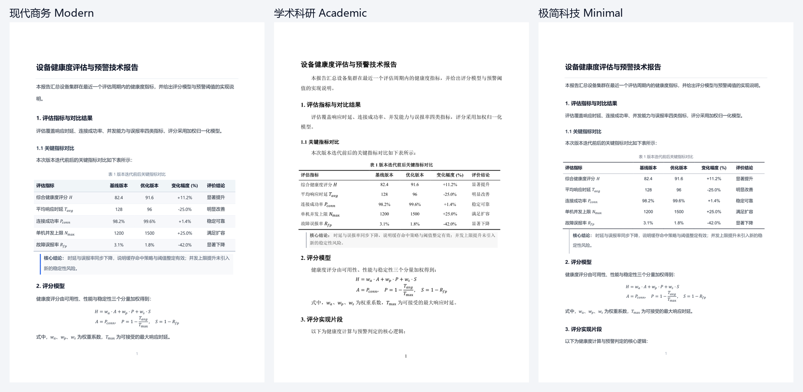

# Markdown to DOCX Pro · 轻量化后台排版助手

专为工程师、科研人员与文档作者打造的高颜值 Markdown 转 Word (.docx) 后台常驻小工具。

A Markdown → Word (.docx) desktop utility with three production-grade typography presets, smart table layout, native OMML equations, and a system-tray workflow.



---

## 📦 安装

```bash
git clone https://github.com/PuddingTower/md2docx-pro.git
cd md2docx-pro
pip install -r requirements.txt
```

- Python 3.10+
- Pandoc 由 `pypandoc` 自动下载；也可自行安装并加入 `PATH`
- 图形界面与托盘通知依赖 PyQt6；开机自启与托盘气泡目前仅在 Windows 上验证

---

## 🌟 核心特性

1. **轻量化后台常驻 (`app.pyw`)**：
   - 采用 Windows 原生无黑框 `pythonw` 模式运行，常驻任务栏右下角系统托盘。
   - 窗口关闭（X）自动最小化至托盘，不占任务栏空间，随时待命。
   - 托盘右键菜单支持：唤出窗口、一键转换剪贴板、打开输出目录、退出。
   - 转换完成触发 Windows 原生桌面通知气泡，点击气泡直接打开生成的 Word。

2. **高颜值 Material Design 3 界面**：
   - 经典 MD3（Material You）卡片式设计与视觉动效。
   - **Hero 拖拽区**：支持将单个/多个 `.md` 文件或包含 Markdown 的文件夹直接拖入，自动识别。
   - **剪贴板智能检测**：按下 `Ctrl+V` 或点击“从剪贴板粘贴并转换”，自动区分复制的文件或复制的纯 Markdown 文本。
   - **转换历史卡片**：展示近期转换记录，提供一键“📄 打开 Word”与“📂 定位目录（高亮选中文件）”。

3. **就地自动生成（零心智负担）**：
   - 无论是拖入的文件还是剪贴板复制的文件，**均自动在检测到的 .md 所在同级目录下生成同名 .docx**！
   - 防冲突保护：若文件正在被 Word 占用编辑，自动生成 `(1).docx`，防止权限冲突闪退。

4. **专业出版级排版质感**（三套风格各自成立，不再只是换颜色）：
   - **统一的版面基础**：A4 纸（21 × 29.7 cm），上下 2.54 cm、左右 2.2 cm 页边距，页脚居中页码；正文行距、标题垂直节奏按风格单独定义。
   - **中西文字体分工**：西文与数字走拉丁字体，中文走中文字体，代码统一 Consolas；已清除 Word 主题色/主题字体对自定义样式的覆盖。
   - **表格（本次重做的重点）**：
     - 表格自动占满版心，按内容长度智能分配列宽（中文字符按双宽计算、公式按 OMML 实际内容估算），数字列不会被长文字挤扁。
     - **现代商务**：淡蓝灰表头（`#F1F5F9`）+ 表头下细线，数据行间隔以极浅底色分组，无竖线，行高紧凑、单元格内边距统一。
     - **学术科研**：标准三线表（顶/底 1.5 pt、栏目线 0.75 pt、无竖线），表内文字 10.5 pt，表题居中加粗置于表上方。
     - **极简科技**：纯灰阶三线结构，不加底色，仅用 0.5–1 pt 细线表达层级。
     - 跨页长表自动重复表头（`tblHeader`），单行禁止跨页断开（`cantSplit`），单元格垂直居中。
   - **表题 / 图题识别**：表格前一行以「表 1…」「Table 1…」开头时自动套用表题样式；图片下一行以「图 1…」「Figure 1…」开头时自动套用图题样式。
   - **引用块（Blockquote）**：左侧强调色竖条 + 极浅底色，连续多段引用会合并成一条连续竖条。
   - **代码块**：Consolas 等宽字体、浅色底、左侧细竖条，块内文字不再误用行内代码配色，整块禁止跨页拆开。
   - **原生 OMML 数学公式**：行内公式与多行 display 公式自动编译为 Word 原生可编辑矢量公式，表格内公式宽度参与列宽计算。
   - **中文标点保护**：清洗阶段只归一化全角字母/数字与不可见空格，不再把中文的「，。：（）」改成半角 ASCII。
   - **排版防孤行**：各级标题强制绑定后段（`keep_with_next`），杜绝标题留在上一页页脚。

---

## 🚀 启动与使用方式

### 方式 1：双击批处理一键后台运行（推荐）
双击运行当前目录下的：
```bash
start_bg.bat
```
程序将以后台模式启动并常驻在系统托盘，同时弹出现代 MD3 GUI 界面。

### 方式 2：Python 启动
- **后台常驻（无控制台黑框）**：
  ```bash
  pythonw app.pyw
  ```
- **普通启动（调试模式）**：
  ```bash
  python app.pyw
  ```
- **命令行批处理（CLI）**：
  ```bash
  # 转换当前目录下所有 md 文件（现代商务风格）
  python main.py

  # 转换指定文件（学术论文风格）
  python main.py -f "C:\path\to\report.md" -p academic
  ```

### 方式 3：开机自启
如果希望每次开机自动在后台托盘待命：
```bash
# 开启自启
python setup_autostart.py

# 取消自启
python setup_autostart.py --remove
```

---

## 🎨 三套排版风格预设

在界面右上角下拉菜单中可随时切换：

| 风格预设 | 推荐场景 | 字体搭配 | 标题语言 | 表格风格 |
| :--- | :--- | :--- | :--- | :--- |
| **现代商务 (Modern)** | 工程师报告、技术汇报、企业文档 | Segoe UI + 微软雅黑 | 墨黑标题 + 细发丝分隔线 | 淡蓝灰表头 + 浅色分组行（无竖线） |
| **学术科研 (Academic)** | 学术论文、毕业设计、科研申报 | Times New Roman + 宋体（标题黑体） | 纯黑居中层级 + 首行缩进 2 字符 | 规范三线表（1.5 pt / 0.75 pt） |
| **极简科技 (Minimal)** | 开发笔记、敏捷文档、开源指南 | Arial + 微软雅黑 | 灰阶层级 + 单线分隔 | 纯灰阶三线结构，无底色 |

三套风格的首页渲染对比见 [`preview/style-compare.png`](preview/style-compare.png)。

---

## 📂 模块结构说明

```
md2docx-pro/
├── app.pyw                  # 【核心】无黑框后台常驻运行主入口
├── main.py                  # 双模式入口（GUI / CLI 命令行）
├── start_bg.bat             # Windows 一键后台启动快捷脚本
├── setup_autostart.py       # 开机自启快捷方式配置工具
├── requirements.txt         # 运行依赖（PyQt6 / python-docx / pypandoc）
├── core/                    # 排版与转换核心引擎
│   ├── cleaner.py           # 脏代码块/LaTeX语法/标题表格空行智能清洗
│   ├── templates.py         # 现代/学术/极简三套 Word 模板引擎
│   ├── postprocessor.py     # 智能列宽表格/表题识别/引用与代码块排版
│   └── converter.py         # 转换调度器与防冲突保存
├── ui/                      # Material Design 3 桌面交互层
│   ├── styles.py            # MD3 全套配色与 QSS 样式表
│   ├── icons.py             # 内存动态绘制的高分辨率 Material 矢量图标
│   ├── tray.py              # 系统托盘与 Windows 桌面气泡通知控制器
│   └── main_window.py       # 拖拽区 / 剪贴板转换 / 任务历史卡片主窗口
├── templates/               # 运行期自动生成的基准模板缓存（不入库）
├── tests/                   # 单元测试与含公式、代码、三线表的测试样例
└── preview/                 # 三套风格渲染对比图
```

---

## ⚖️ 开源协议

本项目基于 [MIT License](LICENSE) 开源。

